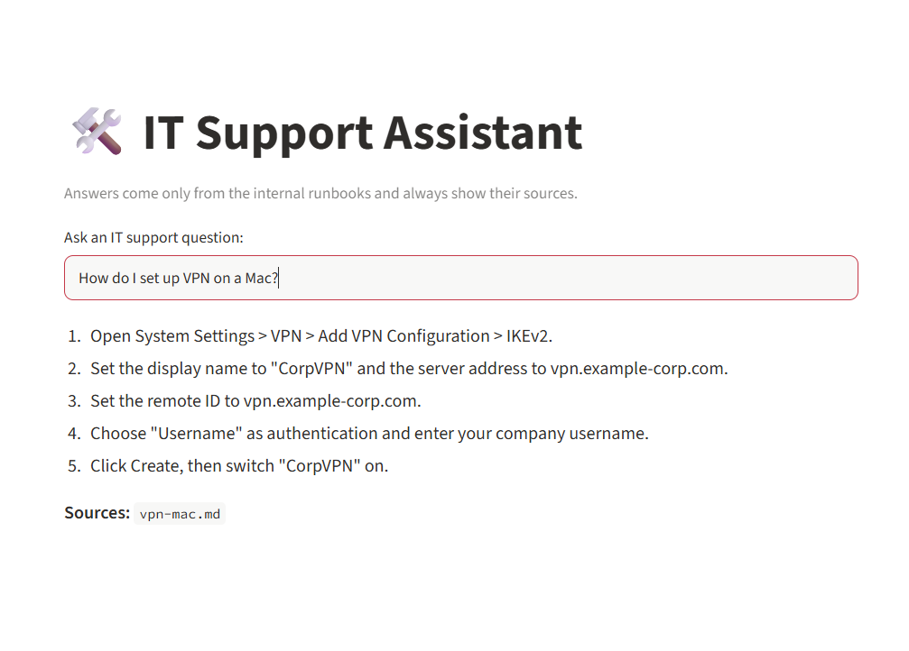
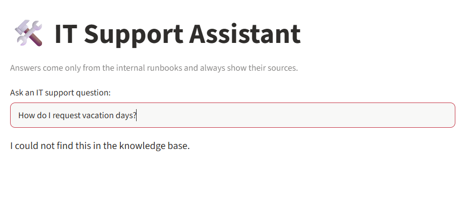

# IT Support Assistant (RAG)

🇵🇱 **Po polsku (skrót):** Asystent IT oparty na RAG (Retrieval-Augmented Generation), który odpowiada na pytania z zakresu wsparcia IT wyłącznie na podstawie wewnętrznych instrukcji (runbooków), zawsze podaje źródła i odpowiada „nie wiem”, gdy w bazie wiedzy nie ma odpowiedzi. Projekt napisany w Pythonie z użyciem API OpenAI i bazy wektorowej Chroma. Zawiera własny zestaw 28 pytań testowych do oceny jakości wyszukiwania. Szczegóły poniżej po angielsku.

---

A small Retrieval-Augmented Generation (RAG) assistant that answers IT support questions **only from internal runbooks**, always shows its sources, and says "I don't know" when the answer is not in the knowledge base. It is built around a typical service desk scenario (L1/L2 support).

> All runbooks in this repository are fictional sample data.

## Demo





## How it works

1. **Ingest** (`src/ingest.py`): reads the runbooks, splits them into chunks (400 characters, 80 overlap), creates embeddings (`text-embedding-3-small`) and stores them in a local Chroma database.
2. **Retrieve** (`src/retrieve.py`): embeds the question and finds the 3 closest chunks (cosine distance).
3. **Answer** (`src/answer.py`): filters the chunks with two thresholds (see below), sends the remaining ones to the model (`gpt-4o-mini`, `temperature=0`) and returns the answer with the names of the source files.
4. **UI** (`app.py`): a simple Streamlit page.
5. **Evaluation** (`eval/`): a test set and a script that measures retrieval quality.

## Reducing hallucinations

- **Distance threshold (`MAX_DISTANCE = 0.55`):** if no chunk is close enough to the question, the assistant answers "I could not find this in the knowledge base" without calling the model.
- **Relative threshold (`RELATIVE_MARGIN = 0.1`):** only chunks within 0.1 of the best match are passed on, so a similar but wrong document is less likely to end up in the context and in the sources.
- **Grounded prompt:** the model is told to answer only from the provided context and to say it does not know otherwise.
- **Sources:** every answer lists the runbooks it was built from. If the model answers "I do not know", no sources are shown.

## Evaluation

I wrote a small test set of **28 questions**: 18 whose answer is in the runbooks (each with the expected document) and 10 whose answer is not (some unrelated, some close to existing topics). `eval/run_eval.py` measures **retrieval only**; the language model is not called.

**Retrieval quality:** the correct document was the closest result for **18/18** in-scope questions (top-1 and top-3), including questions phrased differently from the runbooks.

**Distance threshold** (chunk size 400, overlap 80):

| max_distance | In-scope questions answered | Out-of-scope questions rejected |
|---|---|---|
| 0.4 | 11/18 | 10/10 |
| 0.45 | 15/18 | 10/10 |
| 0.5 | 17/18 | 10/10 |
| **0.55** (chosen) | **18/18** | 9/10 |
| 0.6 | 18/18 | 7/10 |
| 0.65 | 18/18 | 6/10 |

**Chunk size** (threshold 0.55, relative margin 0.1):

| Chunk size / overlap | Chunks | Top-1 / Top-3 | Hardest in-scope question (distance) | Out-of-scope rejected | Only the correct document in sources |
|---|---|---|---|---|---|
| 250 / 50 | 31 | 18/18 | 0.530 | 8/10 | 18/18 |
| **400 / 80** (chosen) | 23 | 18/18 | 0.538 | 9/10 | 18/18 |
| 700 / 140 | 12 | 18/18 | 0.536 | 9/10 | 18/18 |

On these short runbooks, chunk size made no meaningful difference: the only change is one more out-of-scope question passing at 250. At 700 every runbook is a single chunk, so it effectively means "no chunking". I kept 400/80.

Run it yourself: `python eval/run_eval.py` (the `Settings:` line at the top shows which configuration was measured).

## What worked and what didn't

- **Worked:** retrieval. All 18 in-scope questions found the right document, and two deliberately similar runbooks (VPN for Mac and for Windows) were told apart.
- **Didn't work at first:** an initial threshold of 0.6 let an out-of-scope question ("How do I request vacation days?", distance 0.580) through. The model refused to invent an answer, but the threshold should have caught it.
- **No single threshold separates everything:** after I added more out-of-scope questions, the closest one (Outlook email signature, 0.535) turned out to be slightly *closer* to the knowledge base than the hardest in-scope question ("I cannot see drive S:", 0.538). A threshold of 0.5 rejects all 10 out-of-scope questions but also rejects that in-scope one; 0.55 accepts all in-scope questions but lets the signature question through.
- **How I handled it:** I kept 0.55 and rely on the prompt as a second layer. In a manual test the signature question passed the threshold, but the model answered "I do not know". I verified this on one question only.
- **Relative margin helps with sources:** at threshold 0.55, without a margin a loosely related extra document appeared among the sources for 6 of 18 in-scope questions (12/18 clean). With a margin of 0.05 or 0.1 all 18 were clean, and the correct document was kept in every case. Larger margins (0.15 and 0.2) let most of the extra documents back in (13/18 and 12/18 clean).
- **Sensitive to wording:** on the 700/140 index, removing the colon from "I cannot see drive S:" changed the distance from 0.536 to 0.555, just over the threshold, and the assistant answered that it could not find it.

## Limitations

- Small, fictional dataset (12 runbooks).
- The 28 test questions were written by me, and the thresholds were tuned on the same questions, so the results are somewhat optimistic. A separate test set is needed.
- The evaluation measures retrieval only, not the quality or completeness of the generated answer. The model's refusal behaviour was checked manually on one out-of-scope question.
- Distance thresholds are fragile near the boundary (see above).
- No user access control, no automatic knowledge base updates, answers only in the language of the runbooks (English).

## Project structure

```
it-support-rag/
├── app.py              # Streamlit interface
├── data/runbooks/      # 12 sample runbooks (.md)
├── src/
│   ├── config.py       # models, chunk size, thresholds
│   ├── ingest.py       # build the vector database
│   ├── retrieve.py     # find the closest chunks
│   └── answer.py       # filter, ask the model, return sources (CLI)
├── eval/
│   ├── questions.csv   # 28 test questions with expected documents
│   └── run_eval.py     # retrieval evaluation
├── docs/               # demo screenshots
├── requirements.txt
└── .env.example
```

## How to run

Requires Python 3.10+ and an OpenAI API key with a small credit balance (the API is billed separately from ChatGPT subscriptions).

```bash
git clone https://github.com/nadiiameshcheriak-ops/it-support-rag.git
cd it-support-rag
python -m venv venv
venv\Scripts\activate            # Windows (macOS/Linux: source venv/bin/activate)
pip install -r requirements.txt
copy .env.example .env           # Windows (macOS/Linux: cp .env.example .env)
```

Open `.env` and put your key in it (`OPENAI_API_KEY=...`). Never commit this file.

```bash
python src/ingest.py             # builds the vector database in chroma_db/
streamlit run app.py             # web interface at http://localhost:8501
python src/answer.py             # or: command-line version with debug distances
python eval/run_eval.py          # evaluation
```

### Troubleshooting (Windows)

If `python src/ingest.py` fails with `ImportError: DLL load failed while importing cygrpc: An Application Control policy has blocked this file`, Windows Smart App Control is blocking a newer `grpcio` build. `requirements.txt` pins `grpcio==1.78.2`, which worked in my setup.

## Next steps

- Evaluate the full pipeline: run the model on all out-of-scope questions and check that it always refuses, and check answer completeness.
- Build a separate, larger test set that is not used for tuning thresholds.
- Try more realistic data (longer runbooks, tickets as an additional source).
